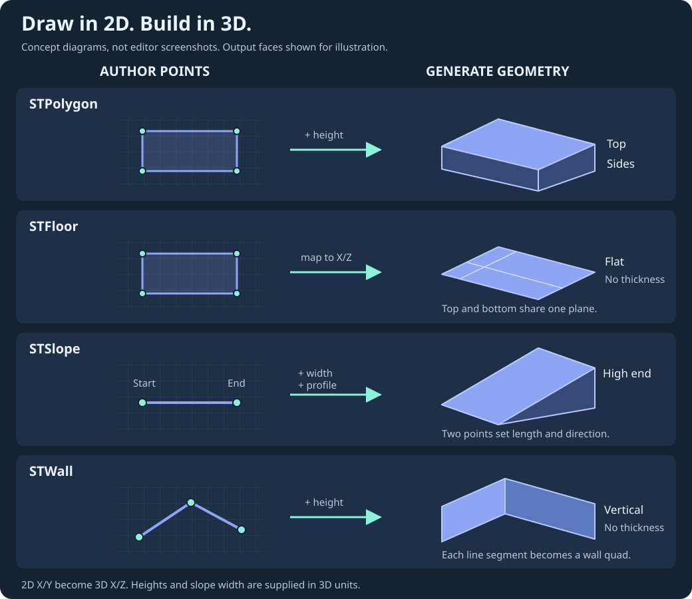

# ShaperTech

Draw polygons and lines in Godot's 2D workspace, then build them into 3D platforms,
floors, ramps, and walls. ShaperTech targets **Godot 4.7.1** and works in the editor
and at runtime.

| Class | Draw | Build |
| --- | --- | --- |
| `STPolygon` | A closed polygon | An extrusion with top, bottom, and side faces |
| `STFloor` | A closed polygon | A flat surface with separate top and bottom faces |
| `STSlope` | Exactly two line points | A ramp with width, curves, and adjustable low corners |
| `STWall` | A line with two or more points | A zero-thickness wall with front and back faces |
| `STContainer` | A hierarchy of shapers | A recursively built group with additive height offsets |

## Start here

Copy this folder, including its resources and `.uid` files, to
`res://ShaperTech` in a Godot project. Let Godot import it, then create a shaper
node or attach its script to the matching `Polygon2D` or `Line2D`. Draw points,
configure **Data** and **Materials**, and press **Build**. Add a `Camera3D` and
lighting to view the result in 3D.

At the default scale, **32 drawing units equal 1 horizontal 3D unit**.
Set a positive height for extrusions: a new `STPolygonData` starts at height `0`.
Use an `STContainer` to build several shapers together.

## Guides

| Guide | Contents |
| --- | --- |
| [Getting started](docs/getting-started.md) | Installation, scene setup, and your first platform |
| [Coordinates and building](docs/coordinates-and-building.md) | Units, placement, startup, timers, output nodes, and collision |
| [Polygon](docs/polygon.md) | Extrusions, skew, presets, offset, and flip tools |
| [Floor](docs/floor.md) | Flat surfaces and ceilings |
| [Slope](docs/slope.md) | Ramp direction, curves, flipped geometry, and corner heights |
| [Wall](docs/wall.md) | Polylines, two-sided surfaces, and skew |
| [Materials and UVs](docs/materials-and-uvs.md) | Surface groups, overrides, tiling, direction, and winding |
| [Containers](docs/containers.md) | Recursive builds, startup precedence, and height offsets |
| [Scripting](docs/scripting.md) | Runtime construction, resource sharing, and public methods |
| [Troubleshooting](docs/troubleshooting.md) | Missing geometry, placement, textures, and performance |
| [Architecture](docs/architecture.md) | Class responsibilities and the mesh-building pipeline |

The illustrations are conceptual diagrams, not editor screenshots. ShaperTech
does not require an editor plugin, a project autoload, or third-party packages.
