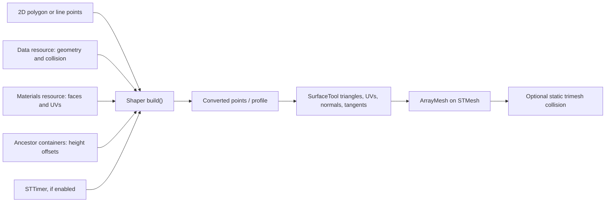

# Architecture and integration reference

[Documentation home](../README.md)

This page describes the current implementation for integrations and maintenance.
For normal editor usage, start with [Getting started](getting-started.md).

## Class responsibilities

| Class | Base | Responsibility |
| --- | --- | --- |
| `ShaperTech` | Implicit `RefCounted` | Shared enums, default resources, numeric thresholds, and the build method name |
| `STUtils` | `RefCounted` | Static conversion, mesh, UV, polygon-tool, resource, and lifecycle helpers |
| `STContainer` | `Node` | Recursive build dispatch and startup ownership |
| `STPolygon` | `Polygon2D` | Extruded polygon generation and polygon-editing tools |
| `STFloor` | `Polygon2D` | Flat polygon generation and polygon-editing tools |
| `STSlope` | `Line2D` | Two-point profile/width generation and footprint preview |
| `STWall` | `Line2D` | Polyline surface generation |
| `STPolygonData` | `Resource` | Polygon geometry and collision settings |
| `STFloorData` | `Resource` | Floor geometry and collision settings |
| `STSlopeData` | `Resource` | Slope geometry, curve, corners, and collision settings |
| `STWallData` | `Resource` | Wall geometry, skew, and collision settings |
| `STPolygonMaterials` | `Resource` | Top, Bottom, Sides settings and override resolution |
| `STFloorMaterials` | `Resource` | Top, Bottom settings and override resolution |
| `STSlopeMaterials` | `Resource` | Slope, Sides, Back, Bottom settings and visibility flags |
| `STWallMaterials` | `Resource` | Front, Back settings and override resolution |
| `STMesh` | `MeshInstance3D` | Generated mesh node with stored `shaper: Node2D` association |
| `STTimer` | `Timer` | Generated rebuild timer with stored `shaper: Node2D` association |

The shapers are independent concrete classes, not subclasses of a common custom
shaper base. Shared static logic lives in STUtils while each shaper retains its
own ordered build stages.

All classes have custom SVG class icons under `resources/icons`. Tool buttons
use built-in editor-theme icon names through `@export_tool_button`.

## Data flow

If a Markdown viewer does not render Mermaid, the pipeline is:
2D points plus resources and ancestor offsets enter `build()`, geometry and UVs
become `SurfaceTool` triangles, those form an `ArrayMesh`, and optional static
collision is derived from that mesh.

## Build stages

Each shaper resets its previous calculated arrays and mesh references, then:

1. Initializes missing Data and Materials resources.
2. Selects the output parent and calculates the horizontal origin.
3. Creates/reuses its mesh node and updates/removes its automatic timer.
4. Validates input and calculates transformed geometry.
5. Emits each enabled material group into its own surface work.
6. Assigns the resulting mesh, vertical placement, and visibility.
7. Replaces generated collision according to current settings.

Polygon and Floor use `Geometry2D.triangulate_polygon`.
Slope samples its two edges at the configured subdivisions.
Wall builds each adjacent point pair independently.

STUtils surface completion skips empty vertex arrays, generates normals and
tangents, and commits to the target ArrayMesh. Its triangle helper omits
exactly zero-area triangles. This is not a general repair system for invalid
or nearly degenerate input.

## STUtils reference

Static methods are grouped here by purpose. Read the source signatures before
using these lower-level integration helpers; the public shaper methods are a
simpler interface for normal usage.

| Area | Methods |
| --- | --- |
| Ancestry | `has_container_ancestor`, `get_container_height_offset` |
| Origin | `get_parent_origin` |
| Generated nodes | `add_generated_node`, `update_mesh_node`, `update_timer_node` |
| Collision | `update_collision` |
| Materials/winding | `get_material`, `get_reverse_faces`, `get_polygon_reverse_faces` |
| UVs | `get_uv`, `get_rotated_uv`, `rotate_uv` |
| Surfaces | `add_triangle`, `add_quad`, `finish_surface` |
| Sampling | `get_triangle_area`, `get_triangle_point`, `get_random_polygon_point` |
| Outline tools | `get_offsetted_polygon`, `get_flipped_polygon` |
| Presets | `get_circle_points`, `get_rectangle_points`, `get_torus_points` |

Generated node helpers look for matching `shaper` references under the selected
parent when the cached reference is invalid. The timer connects to the build
method named by `ShaperTech.METHOD_BUILD`. Deferred node insertion and owner
assignment are scheduled together.

These helpers are not a scene-wide registry. They do not migrate output when
a custom parent changes or remove external output when its authoring node is
deleted.

## Resource and lifecycle boundaries

Build/Nodes/Parent configuration lives on nodes; geometry and collision live on
Data resources; surface selection and UVs live on Materials resources.
Shared resources are not mutated by container offsets.

Property changes are not wired to resource `changed` signals for rebuilding.
Explicit builds and active timer callbacks are the update mechanism.
Editor visibility notifications synchronize mesh visibility when enabled;
runtime visibility is copied during builds, not continuously guaranteed by
these notification handlers.

The library depends on Godot classes and resources inside this folder, not the
legacy game shapers or game-specific globals. It still has UID preloads and an
explicit `res://ShaperTech` texture path, so physical extraction must preserve or
update resource references. The library does not provide a demo project,
EditorPlugin, exporter, runtime camera, or lighting rig.
