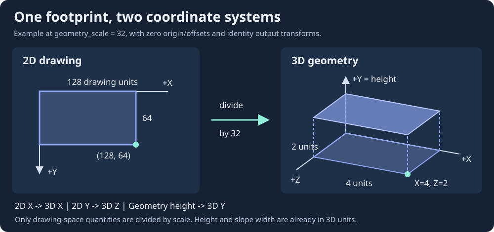

# Coordinates and building

[Documentation home](../README.md)

## From drawing space to 3D



Drawing coordinates describe the horizontal footprint:

| Input | Output |
| --- | --- |
| 2D X | 3D X |
| 2D Y | 3D Z |
| Geometry height/profile | 3D Y |

Let `S` be `geometry_scale`, `R` the rotation from `geometry_rotation`, `p` a
local polygon or line point, and `O` the selected authoring origin:

```text
horizontal_point = (O + Vector2(offset.x, offset.z) + R * p) / S
mesh_y = geometry_distance + offset.y + sum(ancestor_container.height_offset)
```

Here `offset` is `geometry_position_offset`. Wall points are cached before division
by `S`, but their mesh vertices use the same horizontal conversion.

`geometry_scale` must be positive and defaults to `32.0`. Increasing it makes the
same drawn footprint smaller. Heights and slope width are already in 3D units:
they are **not** divided by this scale.

## Shared geometry settings

These settings live in each shaper's **Data** resource:

| Property | Default | Meaning |
| --- | --- | --- |
| `geometry_distance` | `0.0` | Vertical placement of the shape's reference plane |
| `geometry_rotation` | `0.0` | Rotation in degrees of local drawing points before conversion |
| `geometry_position_offset` | `Vector3.ZERO` | X/Z offsets before scale division; Y offset in 3D units |
| `geometry_sync_visibility` | `true` | Copies authoring visibility when building; also handles visibility notifications in the editor |
| `geometry_scale` | `32.0` | Drawing units per horizontal 3D unit |

For a desired horizontal move of 2 units at the default scale, use an X or Z
geometry offset of `64`, not `2`. For a vertical move of 2 units, use Y offset
`2`, distance `2`, or a container height offset of `2`.

Node2D rotation and scale are not applied as a complete authoring transform by
the conversion code. Use `geometry_rotation` and the explicit geometry controls
for predictable output; do not assume rotating/scaling the authoring node is
equivalent to rotating/scaling the generated mesh.

## Parent and origin

The following settings belong to the shaper **node**, not its data resource:

| Property | Default | Meaning |
| --- | --- | --- |
| `parent_custom_node` | `null` | Output destination; `null` means the shaper itself |
| `parent_sync_position` | `true` | Selects the origin calculation described below |

With position synchronization disabled, `O` is the shaper's `global_position`.
With it enabled:

| Output parent's type | Origin `O` |
| --- | --- |
| `Node2D` | Output parent's 2D global position |
| `Control` | Output parent's 2D global position |
| `Node3D` | Shaper's 2D global position plus output parent's global X/Z divided by `S` |
| Other `Node` | Shaper's 2D global position |

The Node3D case has an additional scale division inside the origin calculation;
the final horizontal conversion still divides the entire result by `S`.
This is the current placement rule, not a general world-to-local transform.
The output parent's own 3D transforms also affect its mesh children.

Start with an identity-transform output parent. If you want each shaper's own
2D position to drive placement under a shared output parent, consider disabling
`parent_sync_position`. Rebuild after changing parent settings. Changing output
parents after generated nodes already exist is not a relocation workflow:
recreate/clean up the generated nodes deliberately rather than expecting a build
to reparent them automatically.

## Build controls

All four shaper nodes have these properties:

| Property | Default | Purpose |
| --- | --- | --- |
| `build_on_ready` | `DISABLED` | Startup policy for a standalone shaper |
| `build_mode` | `MANUAL` | Whether builds maintain a repeating timer |
| `build_automatic_interval` | `0.5` seconds | Timer period; minimum enforced interval is `0.001` |
| `build_nodes_in_editor` | `false` | Gives generated mesh/timer/collision nodes edited-scene ownership |
| `build_nodes_deferred` | `true` | Defers output-node addition and owner assignment |

`ShaperTech.BuildOnReadyType`:

| Value | Behavior without a container ancestor |
| --- | --- |
| `DISABLED` | Does not build in `_ready()` |
| `EDITOR_ONLY` | Builds in `_ready()` only in the editor |
| `ALWAYS` | Builds in `_ready()` in both editor and runtime |

`ShaperTech.BuildMode`:

| Value | Behavior when `build()` updates the timer |
| --- | --- |
| `MANUAL` | Removes the shaper's rebuild timer |
| `AUTOMATIC_EDITOR_ONLY` | Maintains a timer only in the editor |
| `AUTOMATIC_ALWAYS` | Maintains a timer in editor and runtime |

Startup and periodic building are independent. Choosing an automatic mode does
not start anything until a build runs. A mode change is applied on the next build;
it is not a property-change listener.

Any container ancestor suppresses the shaper's own startup policy. The outer
container decides whether its subtree builds at startup.
[Containers](containers.md) explains the precedence and remaining timer behavior.

## Generated output and deferred work

Each shaper manages an `STMesh` (`MeshInstance3D`) and, in automatic modes, an
`STTimer` (`Timer`). Their stored `shaper` references associate them with the
authoring node, allowing several shapers to use one output parent.

On each build, mesh surfaces are reconstructed from the current inputs. Treat
these nodes as generated output, not as the place to make permanent manual edits.
With deferred nodes enabled, mesh data may be assigned before the mesh node
actually enters the tree. Do not query tree children immediately and assume the
deferred additions have completed. See [Scripting](scripting.md) for an example.

## Collision

All data resource classes expose:

| Property | Default | Purpose |
| --- | --- | --- |
| `collision_enabled` | `false` | Generates a static triangle-mesh collision body |
| `collision_enabled_in_editor` | `false` | Also permits generation while editing |
| `collision_layer` | `1` | Physics layer bitmask |
| `collision_mask` | `1` | Physics mask bitmask |

The builder creates a `StaticBody3D` and `CollisionShape3D` below the mesh, using
`Mesh.create_trimesh_shape()`. This is static, concave mesh collision, not a convex
or dynamic-body representation.

Collision comes from **emitted mesh surfaces**, not from a separate sealed volume.
Disabled faces do not contribute triangles. A transparent surface can still
contribute collision because it still exists in the mesh.

Every collision update first removes existing direct `StaticBody3D` children from
the generated mesh. Disabling collision and rebuilding therefore clears previous
collision. Do not put unrelated bodies under a generated `STMesh`.
Runtime visibility changes do not disable physics; manage collision separately.
