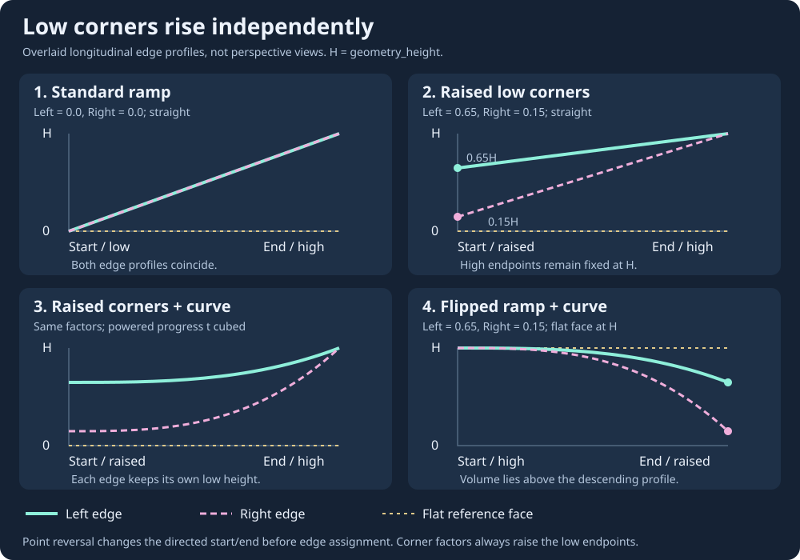

# STSlope

[Documentation home](../README.md)

`STSlope` extends `Line2D`. Exactly two points define its directed centerline.
The builder adds a width, a height profile, optional closing faces, and a flat
reference face. It does not extrude an arbitrary multi-point path.

## Basic ramp

`STSlopeData` defaults:

| Property | Default | Meaning |
| --- | --- | --- |
| `geometry_height` | `2.0` | High level in local 3D Y |
| `geometry_width` | `2.0` | Full ramp width in 3D units |
| `geometry_reverse_points` | `false` | Swaps start/end before constructing the ramp |
| `geometry_flipped` | `false` | Reverses the height profile and moves the flat reference face to the high level |
| `geometry_curve_value` | `0.0` | Blend/extrapolation between straight and powered progress |
| `geometry_curve_segments` | `16` | Subdivision count, clamped to at least 1 for building |
| `geometry_curve_strength` | `3.0` | Exponent for the powered curve |
| `geometry_corner_left` | `0.0` | Low-corner height factor for one edge |
| `geometry_corner_right` | `0.0` | Low-corner height factor for the other edge |

A line from `(0, 0)` to `(128, 0)` at scale `32`, with default width and height,
creates a ramp 4 units long, 2 units wide, and 2 units high.
The normal ramp starts low at the first point and finishes high at the second.
The `Line2D.width` setting affects the authoring line, not the generated ramp
width; use `geometry_width` for the mesh.

## Direction, left/right, and flipping

Point reversal swaps the endpoints **before** width and corner calculations.
Left/right factors therefore follow that directed ramp, not permanent world
sides.

For exact orientation, take the normalized horizontal direction `d = (dx, dz)`
and perpendicular `n = (-dz, dx)`. The array called Left is on `center - n * width/2`;
Right is on `center + n * width/2`. This avoids ambiguity when viewing the ramp
from different camera angles.

Flipping is not just changing which end is low:

| Mode | Profile at start | Profile at end | Flat reference face |
| --- | --- | --- | --- |
| Normal | Low corner factors times height | Full height | Y `0` |
| Flipped | Full height | Low corner factors times height | Y `height` |

A flipped ramp occupies the region **above** its descending profile, up to the
high flat face. Use point reversal to change travel direction without switching
the flat reference face.

## Corner heights



In **Data > Geometry > Corners**, each factor ranges from `0.0` to `1.0`
and is clamped during building:

| Factor | Height of that edge's low endpoint |
| --- | --- |
| `0.0` | `0` |
| `0.5` | Half `geometry_height` |
| `1.0` | Full `geometry_height` |

The two high endpoints remain at full height. Set only one factor above zero
to create a corner transition; the surface is triangulated between the two
independently evaluated edges. The diagonal can matter visually on a twisted
quad, so a corner ramp is not necessarily a single planar slope.

Both factors at `1.0` create a level profile at the high height. In normal mode
this can form a full-height block if all closing faces are enabled. In flipped
mode the profile coincides with the upper reference plane, giving zero thickness;
enabling both overlapping faces can produce coplanar rendering artifacts.

## Curves

The curve is a longitudinal height profile, not a bend in the 2D centerline.
With normalized progress `t` from start `0` to end `1`:

```text
g(t) = lerp(t, pow(t, geometry_curve_strength), geometry_curve_value)

normal edge height  = H * lerp(corner_factor, 1, g(t))
flipped edge height = H * lerp(1, corner_factor, g(t))
```

Value `0` is straight; `1` uses the full powered profile. A negative curve value
extrapolates away from the powered curve and can overshoot the nominal height.
`geometry_height` and `get_top_position()` are therefore not guaranteed bounds
for every curved configuration.

Increase segments for a smoother curve; one segment contains only the endpoint
heights and cannot display intermediate curvature. Both edges share progress
but retain independent corner heights and arc lengths for slope UVs.

## Faces and materials

`STSlopeMaterials` has these groups:

| Group | Exterior flag | Default exterior | Extra inward-face flag |
| --- | --- | --- | --- |
| Slope | `slope_top_enabled` | `true` | `slope_double_sided` |
| Sides | `sides_enabled` | `true` | `sides_double_sided` |
| Back | `back_enabled` | `false` | `back_double_sided` |
| Bottom | `bottom_enabled` | `false` | `bottom_double_sided` |

All extra inward-face flags default to `false`. Each group also has material
type, reverse-face mode, and UV settings. Group names refer to builder roles:
in flipped mode the group named Bottom is the **upper** flat face.

Raising normal-mode low corners creates a front opening. The builder closes it
with the **Sides** material and its exterior/inward-face flags; there is no
separate Front material group. In flipped mode the start has zero thickness
and the Back group controls the far-end closure. Enable Back and Bottom if you
need all nondegenerate closing faces. Disabled faces are absent from collision
as well as the visible mesh.

## Footprint and public methods

| Method | Result |
| --- | --- |
| `build() -> void` | Rebuilds geometry, footprint, output nodes, and collision |
| `get_polygon_points() -> PackedVector2Array` | Four local footprint points from the most recent build |
| `get_polygon_border() -> PackedVector2Array` | The same footprint with its first point repeated at the end |
| `STSlopeData.get_top_position() -> float` | Nominal `geometry_distance + geometry_height` |

The footprint uses original local line points and a drawing-space half-width of
`geometry_width * geometry_scale / 2`. It excludes geometry rotation, placement
offsets, and height deformation. It is cached, so build first; an invalid build
clears it. The editor footprint preview uses the `Line2D.default_color`.
